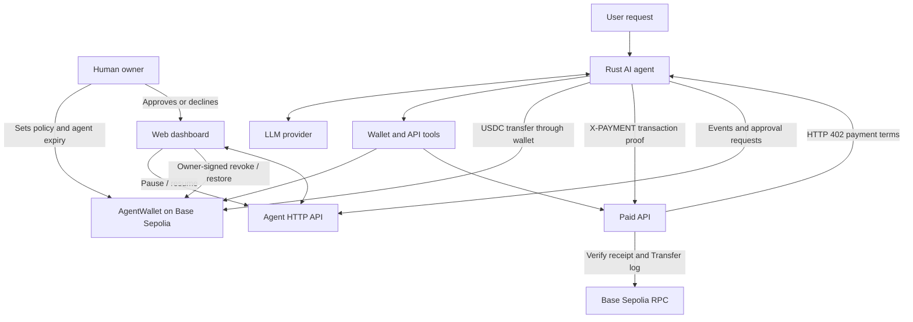

# AgentPay

**AgentPay is an AI-powered on-chain wallet that can make bounded USDC payments and purchase paid API data on its own—without giving the AI unrestricted control of the owner's funds.**

The project combines an LLM-powered agent, a policy-enforcing Solidity wallet, an HTTP 402 payment flow, and a web dashboard. It is currently configured for **Base Sepolia** and is intended for development and demonstrations with testnet assets.

> **Important:** This repository is a testnet-oriented prototype, not an audited wallet or a production payment system. Use test funds only. Never use a valuable owner key or fund the wallet with assets you cannot afford to lose.

## Overview

AI agents can decide when to call tools, but an LLM prompt is not a security boundary. AgentPay separates decision-making from authorization:

- The **LLM** interprets a user's request and selects from a small set of wallet and API tools.
- The **agent service**, written in Rust, validates tool inputs, checks the configured task budget, requests human approval when required, and submits transactions.
- The **AgentWallet smart contract** independently enforces the agent address, key expiry, per-transaction limit, daily spending limit, and recipient allowlist.
- The **paid API** responds with HTTP `402 Payment Required` and payment terms. The agent pays in USDC on Base Sepolia, then retries the request with an on-chain transaction hash as payment proof.
- The **dashboard** displays wallet policy and activity, handles pending approvals, and lets the owner pause or revoke agent access.

The central security principle is that **the LLM is never trusted to enforce spending policy**. The smart contract is the final enforcement layer for transfers made through the agent wallet.

## Key Features

### AI agent and tool calling

The Rust agent uses OpenAI-compatible chat-completions APIs with function/tool calling. The configured provider sequence is:

1. NVIDIA API — `nvidia/nemotron-3-ultra-550b-a55b`
2. Google Gemini — `gemini-3.8-flash`
3. Mistral — `codestral-latest`

The agent attempts providers in sequence and moves to the next provider if one fails. Configure the corresponding API keys in the environment.

The agent exposes these tools to the model:

| Tool | Purpose |
|---|---|
| `get_balance` | Reads the wallet's USDC balance and the agent's ETH gas balance. |
| `get_policy` | Reads the per-transaction cap, daily cap, remaining daily allowance, and agent-key expiry. |
| `send_usdc` | Requests a USDC transfer to a specified address. |
| `list_paid_apis` | Retrieves the paid API catalog and remaining task budget. |
| `pay_for_api` | Calls a catalogued paid endpoint and completes its payment flow if it returns HTTP 402. |

The agent runs a bounded tool-call loop and checks the local kill switch before each model step. The system prompt also treats returned API data as untrusted data rather than instructions.

### Policy-enforced smart wallet

`AgentWallet` is an Ownable Solidity contract that holds an ERC-20 token address configured as USDC. The owner configures an agent address and expiry, spending limits, and approved recipients.

| Policy control | On-chain behaviour |
|---|---|
| Agent authorization | Only the currently registered agent address can call `transferUSDC`. |
| Agent expiry | Agent transfers are rejected after the configured expiry timestamp. |
| Per-transaction cap | A transfer above `maxPerTx` reverts. |
| Daily spending cap | A transfer that exceeds the remaining `maxPerDay` allowance reverts. Spending is tracked by day and resets when the day changes. |
| Recipient allowlist | Transfers are accepted only to addresses enabled by the owner. |
| Owner revocation | The owner can revoke the agent by clearing the registered agent address. |
| Owner policy management | The owner can replace the agent, change limits, update recipient permissions, and withdraw tokens. |

The contract uses OpenZeppelin `Ownable`, `IERC20`, and `SafeERC20`. The agent cannot change the contract's owner-only settings.

**USDC amounts use six decimal places** in the contract. For example, `1 USDC` is represented as `1_000_000` base units.

### HTTP 402 / x402-style API payments

The included Hono API provides a small catalogue of paid ETH-price endpoints:

| Endpoint | Price per call | Response fields |
|---|---:|---|
| `GET /api/price/basic` | 0.01 USDC | `usd` |
| `GET /api/price/pro` | 0.05 USDC | `usd`, `change_24h_pct`, `volume_24h_usd` |

The values returned by this demo API are generated by the included sample implementation; they should not be treated as a live market-price feed.

The payment sequence is:

1. The agent requests an endpoint.
2. The API responds with HTTP `402` and an `accepts` object containing the payment scheme, network, token, payee, required amount, and resource.
3. The agent checks that the network is `base-sepolia`, the requested token matches its configured USDC address, and the price fits within the remaining task budget.
4. The approval layer asks the owner for approval when the amount is above the configured threshold.
5. The agent sends USDC through `AgentWallet`.
6. The agent retries the API request with an `X-PAYMENT` header containing the transaction hash.
7. The API checks the transaction receipt and looks for a matching USDC `Transfer` event to the configured payee for at least the required amount. It rejects a reused transaction hash.
8. If verification succeeds, the API returns the protected data.

The agent also checks that the requested endpoint appears in the API catalogue, constrains endpoint paths, applies a per-task budget, and filters the response to a small set of expected numeric fields.

### Human approval

Payments above `APPROVAL_THRESHOLD_USDC` require an explicit decision. The default approval mode is the dashboard; `APPROVAL_MODE=terminal` selects terminal approval.

Dashboard approvals show the amount, recipient, purpose, and agent-provided reason. The owner can approve or decline. Requests expire after `APPROVAL_TIMEOUT_SECS` (default: 120 seconds); an unanswered request is declined.

Approval is an additional human-control layer, not a replacement for contract policy. Approving a payment does not bypass the wallet's on-chain limits or recipient allowlist.

### Pause, revoke, and restore

AgentPay provides multiple ways to stop spending:

- **Pause:** the agent service's local kill-switch file prevents further agent steps while it exists. The dashboard can pause and resume the service.
- **Revoke:** the wallet owner calls `revokeAgent()` on-chain. The revoked address can no longer transfer through the wallet.
- **Restore:** the owner can register an agent address again with a new expiry using `setAgent()`.

Pausing is an operational control on the agent process. Revocation is the on-chain control that prevents the agent address from using the wallet, even if the agent process is still running.

### Dashboard and activity history

The Next.js dashboard provides:

- Current agent state: active, paused, revoked, or expired.
- Wallet USDC balance and agent ETH gas balance.
- Per-payment and daily spending limits, plus remaining daily allowance.
- Agent-key expiry information.
- Pending approval requests with approve/decline actions.
- Activity entries for successful, declined, and contract-blocked payments.
- Transaction links to the Base Sepolia explorer.
- CSV export of activity.
- Owner-wallet connection for on-chain revoke and restore actions.

The dashboard polls the agent API for status and events. Its server-side API routes forward requests to the Rust agent service using a bearer token.

## Technology Stack

| Area | Technologies | How they are used |
|---|---|---|
| Agent runtime | Rust, Tokio | Runs the asynchronous agent, CLI commands, and HTTP service. |
| LLM integration | NVIDIA API, Google Gemini API, Mistral API; OpenAI-compatible chat completions | Generates responses and tool calls, with provider failover. |
| LLM tool interface | JSON function calling | Exposes wallet and paid-API operations to the model. |
| Blockchain network | Base Sepolia | Test network for wallet deployment, USDC transfers, and payment verification. |
| Smart contracts | Solidity `^0.8.24`, Foundry | Implements and tests the policy-enforcing `AgentWallet`. |
| Contract libraries | OpenZeppelin Contracts, forge-std | Ownership, ERC-20 safe transfers, and Solidity testing utilities. |
| Rust Ethereum client | Alloy | Connects to the EVM, reads wallet state, signs, and sends transactions. |
| Agent HTTP server | Axum | Exposes authenticated status, events, approvals, pause, and resume endpoints. |
| Agent HTTP client | Reqwest | Calls LLM endpoints and the paid API. |
| Agent serialization/configuration | Serde, Serde JSON, dotenvy, tracing | JSON messages, environment configuration, and diagnostics. |
| Paid API server | Bun, TypeScript, Hono | Serves the catalogue and HTTP 402-protected API endpoints. |
| API chain interaction | viem | Reads Base Sepolia transaction receipts and verifies USDC transfer logs. |
| API database | Bun SQLite | Stores used payment transaction hashes to prevent replay. |
| Frontend framework | Next.js 16, React 19, TypeScript | Renders the dashboard and its server-side API routes. |
| Styling and UI | Tailwind CSS 4, shadcn/ui components, Base UI, Lucide React | Dashboard styling, accessible UI primitives, and icons. |
| Frontend data/state | TanStack Query, wagmi, viem | Polls agent data and connects the owner's browser wallet to Base Sepolia. |
| Animation | Motion | Dashboard transitions and activity/approval animations. |
| JavaScript package manager | Bun | Installs and runs the web and paid API workspaces. |
| Smart contract tooling | Foundry (Forge) | Builds, tests, and deploys the Solidity contract. |

## Architecture



### Trust boundaries

- The LLM proposes actions; it does not own the wallet's owner authority.
- The agent uses a separate private key whose address must be registered in the wallet contract.
- Contract policy is checked when the transfer executes on-chain.
- The paid API's response is untrusted. The agent filters returned fields and the system prompt instructs the model not to follow instructions embedded in API data.
- Dashboard-to-agent requests use `DASHBOARD_TOKEN`; the dashboard's pause and resume routes also check request origin.
- The owner uses a connected browser wallet on Base Sepolia to sign revoke and restore transactions.

## Prerequisites

Install the following before running the project:

- [Rust](https://www.rust-lang.org/tools/install) with Cargo.
- [Bun](https://bun.sh/) (the repository's web package declares Bun as its package manager).
- [Foundry](https://getfoundry.sh/) for contract compilation, testing, and deployment.
- A browser wallet such as MetaMask, configured for Base Sepolia, for owner dashboard actions.
- Access to at least one configured LLM provider: NVIDIA, Gemini, or Mistral.
- Base Sepolia ETH for gas and Base Sepolia USDC for test payments.
- A Base Sepolia RPC endpoint. The code defaults to `https://sepolia.base.org` if `BASE_SEPOLIA_RPC_URL` is omitted.

## Configuration

Create a `.env` file in the repository root for the Rust agent and paid API. Do not commit it. Configure the dashboard's matching token in `web/.env.local`.

### Agent and shared environment

| Variable | Required | Description |
|---|---|---|
| `AGENT_PRIVATE_KEY` | Yes | Private key for the agent signer. It must correspond to the agent address registered in `AgentWallet`. Never use the owner's key here. |
| `AGENT_WALLET_ADDRESS` | Yes | Deployed `AgentWallet` contract address. |
| `USDC_ADDRESS` | Yes | USDC ERC-20 contract address on Base Sepolia. Must match the token configured in the wallet and paid API. |
| `BASE_SEPOLIA_RPC_URL` | No | Base Sepolia JSON-RPC URL. Defaults to `https://sepolia.base.org`. |
| `NVIDIA_API_KEY` | If using NVIDIA | API key for the first configured LLM provider. |
| `GEMINI_API_KEY` | If using Gemini | API key for the second configured LLM provider. |
| `MISTRAL_API_KEY` | If using Mistral | API key for the third configured LLM provider. |
| `TASK_BUDGET_USDC` | No | Maximum cumulative amount the agent may spend on paid API calls in one agent process. Defaults to `0.50`. |
| `PAID_API_URL` | No | Base URL of the paid API. Defaults to `http://localhost:4020`. |
| `APPROVAL_THRESHOLD_USDC` | No | Payments above this amount require human approval. |
| `APPROVAL_MODE` | No | Set to `terminal` for terminal approval; otherwise dashboard approval is used. |
| `APPROVAL_TIMEOUT_SECS` | No | Approval request timeout in seconds. Defaults to `120`. |
| `DASHBOARD_TOKEN` | Required for dashboard service | Bearer token shared by the agent API and dashboard. The agent requires at least 24 characters. |
| `AGENT_API_PORT` | No | Rust agent API port. Defaults to `4030`. |
| `EVENT_LOG` | No | JSON Lines activity log path. Defaults to `events.jsonl`. |
| `APPROVAL_DIR` | No | Directory used for approval request state. |
| `KILL_SWITCH_FILE` | No | Local kill-switch file path. Defaults to `KILL`. |

### Paid API environment

The paid API uses these settings. It reads the same `USDC_ADDRESS` and `BASE_SEPOLIA_RPC_URL` values as the agent.

| Variable | Required | Description |
|---|---|---|
| `PAY_TO` | Yes | Checksummed or valid EVM address that receives API payments. |
| `USDC_ADDRESS` | Yes | USDC token contract address used to verify payment events. |
| `BASE_SEPOLIA_RPC_URL` | No | RPC URL used to read transaction receipts. Defaults to `https://sepolia.base.org`. |
| `PORT` | No | Paid API server port. Defaults to `4020`. |
| `DB_PATH` | No | SQLite database path for used transaction hashes. Defaults to `used-tx.sqlite`. |
| `ENABLE_EVIL` | No | Set to `1` to enable the deliberately malicious test endpoint for prompt-injection demonstrations. Keep disabled for normal use. |
| `EVIL_ATTACKER` | No | Attacker address included in the malicious test response. Defaults to a dead address. |

Example `.env` template:

```dotenv
# Base Sepolia
BASE_SEPOLIA_RPC_URL=https://sepolia.base.org
USDC_ADDRESS=0xYourBaseSepoliaUsdcTokenAddress

# Agent signer and deployed wallet
AGENT_PRIVATE_KEY=0xYourDedicatedAgentPrivateKey
AGENT_WALLET_ADDRESS=0xYourAgentWalletContractAddress

# Choose one or more LLM providers
NVIDIA_API_KEY=
GEMINI_API_KEY=
MISTRAL_API_KEY=

# Agent spending and approval controls
TASK_BUDGET_USDC=0.50
APPROVAL_THRESHOLD_USDC=0.10
APPROVAL_MODE=dashboard
APPROVAL_TIMEOUT_SECS=120

# Agent/dashboard communication
DASHBOARD_TOKEN=replace-with-a-random-secret-at-least-24-characters
AGENT_API_PORT=4030

# Paid API
PAID_API_URL=http://localhost:4020
PAY_TO=0xYourPaymentRecipientAddress
PORT=4020

# Optional local state
EVENT_LOG=events.jsonl
APPROVAL_DIR=approvals
KILL_SWITCH_FILE=KILL
DB_PATH=used-tx.sqlite
```

For `web/.env.local`, set the same dashboard token and the agent API URL:

```dotenv
DASHBOARD_TOKEN=the-same-random-secret-used-by-the-agent
AGENT_API_URL=http://127.0.0.1:4030
```

Use a different secure token for your own environment. Do not paste real private keys or secrets into source control, issue trackers, screenshots, or public logs.

## Getting Started

### 1. Install dependencies

From the repository root:

```bash
bun install
```

The Rust agent uses Cargo and the contracts use Foundry; install those toolchains separately if they are not already available.

### 2. Build and test the smart contract

```bash
cd contracts
forge install
forge build
forge test
```

The test suite covers successful transfers, exact transaction limits, per-transaction and daily cap violations, daily reset behaviour, recipient allowlisting, expiry, owner renewal, unauthorized callers, revocation, owner-only policy changes, zero amounts, invalid limits, withdrawals, and a fuzz test for the daily cap.

### 3. Deploy `AgentWallet` to Base Sepolia

Prepare a funded deployer account and the Base Sepolia USDC contract address. The deployment script accepts the owner, token, agent address, expiry duration in days, and limits in USDC base units.

Example (replace all placeholders; keep the private key out of shell history where possible):

```bash
forge script script/Deploy.s.sol:Deploy \
  --rpc-url "$BASE_SEPOLIA_RPC_URL" \
  --private-key "$DEPLOYER_PRIVATE_KEY" \
  --broadcast \
  --sig "run(address,address,address,uint256,uint256,uint256)" \
  "$OWNER_ADDRESS" \
  "$USDC_ADDRESS" \
  "$AGENT_ADDRESS" \
  7 \
  2000000 \
  5000000
```

In this example, `2_000_000` is 2 USDC per transaction and `5_000_000` is 5 USDC per day. The deployment script allowlists the owner address by default. Add other recipients using the owner's `setRecipientAllowed(address,bool)` function.

After deployment, set `AGENT_WALLET_ADDRESS` to the deployed contract address. Ensure `AGENT_PRIVATE_KEY` derives exactly the `AGENT_ADDRESS` registered at deployment.

### 4. Start the paid API

In a terminal from the repository root, after configuring `PAY_TO`, `USDC_ADDRESS`, and the RPC URL:

```bash
bun run paid-api
```

The service listens on `http://localhost:4020` by default.

Useful endpoints:

```bash
curl http://localhost:4020/catalog
curl -i http://localhost:4020/api/price/basic
curl -i http://localhost:4020/api/price/pro
```

The paid endpoints should return HTTP 402 when called without a valid `X-PAYMENT` proof.

### 5. Run the agent

In another terminal, from the repository root:

```bash
cargo run -p agent -- balance
```

This checks the configured wallet, token balance, agent address, gas balance, spending policy, and expiry.

Try a natural-language request:

```bash
cargo run -p agent -- ask "How much USDC is in the wallet and what are my spending limits?"
```

To test a paid API purchase:

```bash
cargo run -p agent -- ask "Compare the available ETH price APIs and use the basic endpoint if it is enough. Explain the result."
```

The agent can also be invoked directly for a transfer or API call:

```bash
cargo run -p agent -- send 0xRecipientAddress 0.1
cargo run -p agent -- pay /api/price/basic
```

Direct transfer and paid API commands still use the wallet contract policy; payments above the approval threshold also use the approval flow.

### 6. Start the agent HTTP service

The dashboard talks to the agent's authenticated HTTP API. Start it in another terminal:

```bash
cargo run -p agent -- serve
```

The service binds to `127.0.0.1:4030` by default. It requires `DASHBOARD_TOKEN` and rejects tokens shorter than 24 characters.

### 7. Start the dashboard

In another terminal:

```bash
bun run web
```

Open [http://localhost:3000](http://localhost:3000).

Ensure `web/.env.local` contains the same `DASHBOARD_TOKEN` as the agent and points `AGENT_API_URL` at the agent service. Connect the wallet owner account on Base Sepolia to use owner-only revoke and restore actions.

## CLI Reference

Run commands from the repository root:

| Command | Description |
|---|---|
| `cargo run -p agent -- balance` | Display wallet balance, agent gas balance, spending policy, and expiry. |
| `cargo run -p agent -- ask "<prompt>"` | Send a natural-language request to the AI agent. |
| `cargo run -p agent -- send <address> <amount>` | Request a direct USDC transfer. |
| `cargo run -p agent -- pay <api-path>` | Call a paid API endpoint using the configured wallet and task budget. |
| `cargo run -p agent -- serve` | Start the authenticated HTTP API for the dashboard. |
| `bun run paid-api` | Start the HTTP 402 paid API. |
| `bun run web` | Start the Next.js dashboard. |
| `bun run kill-switch` | Run the repository's kill script to stop the local agent process and activate its kill switch. |

## Security Notes and Limitations

AgentPay is a prototype. Review these points before using it beyond a local test environment:

1. **Testnet only:** the repository is configured for Base Sepolia. Use test USDC and test ETH, not production funds.
2. **No security audit:** the Solidity contract, Rust agent, API payment verifier, and dashboard have not been established as audited.
3. **Separate keys:** keep the owner key separate from `AGENT_PRIVATE_KEY`. The agent signer should have only the authority granted by the wallet contract.
4. **On-chain enforcement:** per-transaction limits, daily limits, expiry, and recipient allowlisting are enforced in `AgentWallet`, not just in model instructions.
5. **Task budget is process-local:** `TASK_BUDGET_USDC` is tracked in the running agent process and resets when that process restarts. It is not a substitute for the contract's on-chain daily limit.
6. **Approval is not authorization:** an owner approval cannot make a disallowed recipient or over-limit transaction pass the contract.
7. **Pause is local:** the kill-switch file stops this agent process from proceeding, but does not revoke the key on-chain. Use `revokeAgent()` for on-chain revocation.
8. **Payment proof model:** the demo API verifies a successful transaction receipt and a matching USDC `Transfer` event to the configured payee. It is a project-specific exact-transaction proof flow, not a claim of full compatibility with every x402 implementation.
9. **Replay protection storage:** used transaction hashes are recorded in a local SQLite database. Keep that database persistent and protected when running the paid API.
10. **Demo data:** the paid API's ETH price and 24-hour metrics are sample values, not a live financial data source.
11. **Prompt injection testing:** `ENABLE_EVIL=1` exposes an intentionally malicious endpoint response for testing whether the agent treats API content as untrusted. Use it only in a controlled local/testnet environment.
12. **Secrets:** protect `.env` and `web/.env.local`, rotate any exposed key, and never commit secrets.

## Testing

Run the Solidity test suite:

```bash
cd contracts
forge test -vv
```

Build the Rust agent:

```bash
cargo check --workspace
```

Check the frontend:

```bash
bun run --cwd web lint
bun run --cwd web build
```

Run the paid API locally and inspect its catalogue and HTTP 402 responses before attempting a wallet-funded payment.

## Roadmap and Possible Extensions

The accompanying project brief describes possible future directions. These are not all implemented in the current repository:

- Agent-to-agent payments and on-chain agent identity/reputation.
- Token swaps with slippage limits.
- Additional paid services and richer API discovery.
- Verifiable or on-chain anchored activity-log hashes.
- More extensive threat modelling and prompt-injection test coverage.
- Production-grade monitoring, deployment, key management, and security review.

## Contributing

Contributions are welcome. For changes involving wallet permissions or payment handling:

- Add or update Foundry tests for contract-level policy changes.
- Keep authorization checks independent of LLM prompts.
- Treat external API responses and tool outputs as untrusted input.
- Avoid logging private keys, bearer tokens, or other secrets.
- Document any new environment variables and operational assumptions.

## License

The repository's root does not currently declare a project-wide license. Check the licensing terms of the individual dependencies and obtain the maintainers' clarification before redistributing the project.